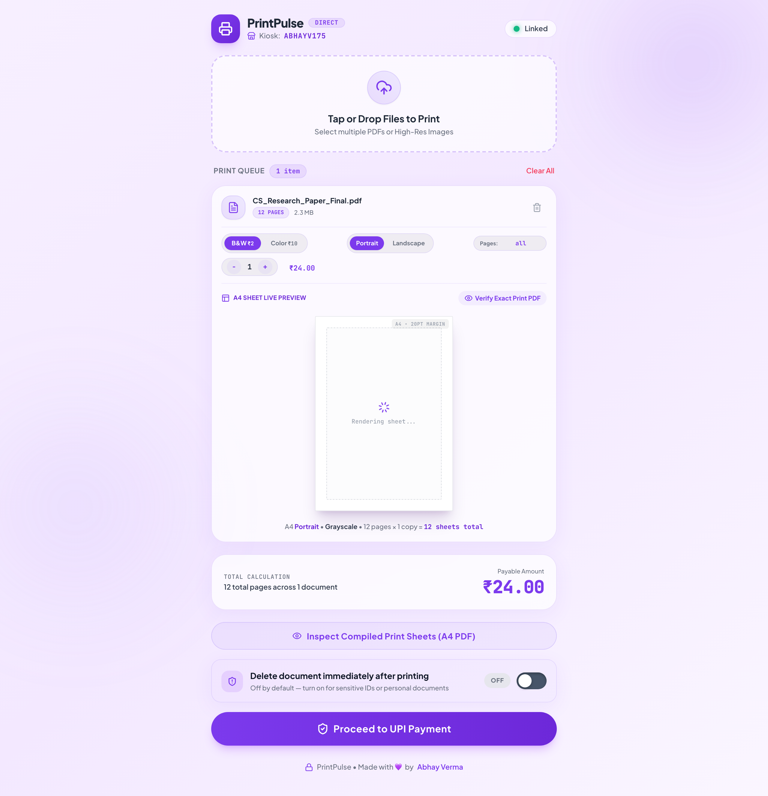
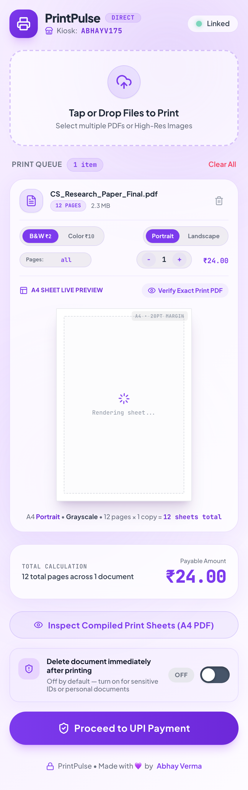
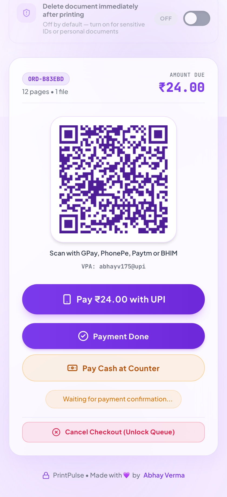
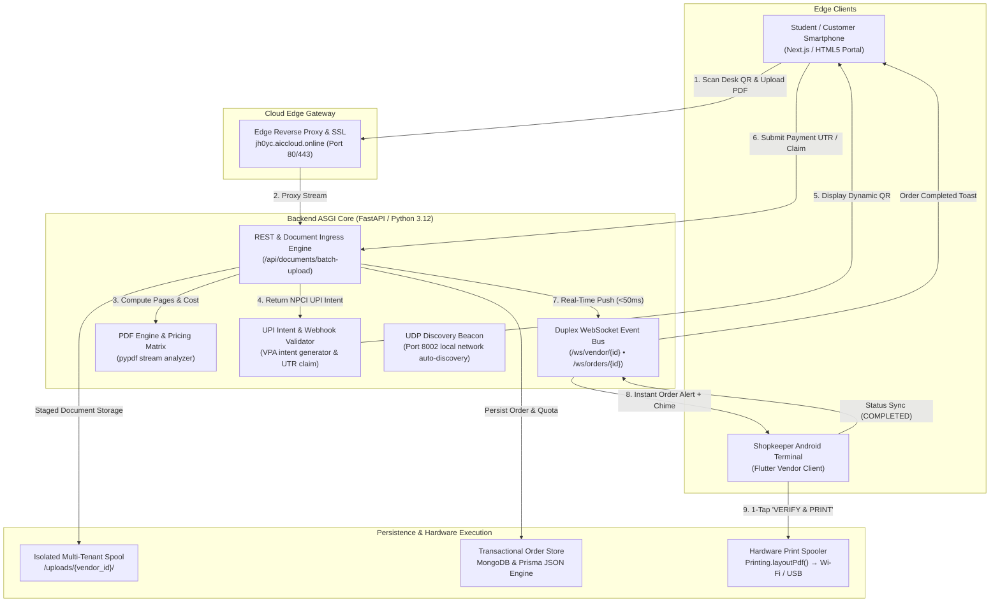

<div align="center">

# 🖨️ PrintPulse
### Zero-Friction Campus & Retail Print-on-Demand Infrastructure

[](https://jh0yc.aiccloud.online/shop/abhayv175)
[](https://fastapi.tiangolo.com/)
[](https://flutter.dev/)
[](https://websockets.spec.whatwg.org/)
[](https://www.docker.com/)
[](https://www.npci.org.in/)

<p align="center">
  <strong>Next-generation cloud-synchronized print ecosystem eliminating pen drives, cables, and kiosk queues.</strong><br>
  Instant web uploads, zero customer app downloads, client-side PDF inspection, direct zero-fee P2P UPI payments, and sub-50ms push spooling to vendor Android tablets.
</p>

[**🌐 Live Customer Web Portal**](https://jh0yc.aiccloud.online/shop/abhayv175) • [**⚡ Cloud API Documentation**](https://jh0yc.aiccloud.online/docs) • [**📱 Flutter Vendor APK**](#-vendor-android-app-setup) • [**👨‍💻 Portfolio & Architect**](https://abhayv175.netlify.app)

---

</div>

## 📸 Real Project Screenshots

### 1. Customer Web Portal & Order Configuration
*Accessed instantly via QR code scan (`https://jh0yc.aiccloud.online/shop/abhayv175`) — 0 app installs required.*

<div align="center">
  
  <p><em>Desktop View: Multi-document queue, automated page detection (12 pages B&W @ ₹2.00 = ₹24.00), orientation toggles, sheet preview, privacy auto-delete switch, and checkout trigger.</em></p>
</div>

<br>

### 2. Mobile Experience & Direct Zero-Fee UPI Settlement
*Optimized for smartphone viewports with instant QR generation and one-tap UPI intents.*

<div align="center">
  <table>
    <tr>
      <td width="50%" align="center">
        
        <br>
        <strong>Mobile Document Configuration</strong>
        <br>
        <em>Page counting, B&W/Color rate calculation, and privacy toggle.</em>
      </td>
      <td width="50%" align="center">
        
        <br>
        <strong>NPCI-Compliant Direct UPI QR Modal</strong>
        <br>
        <em>GPay/PhonePe/Paytm QR, one-tap UPI intent link, & UTR claim verification.</em>
      </td>
    </tr>
  </table>
</div>

---

## ⚡ Core Value Proposition & Pain Points Solved

| Traditional Campus/Shop Printing | The PrintPulse Solution |
| :--- | :--- |
| **Pen Drive Malware:** Students insert infected USB sticks into kiosk PCs. | **Zero Hardware Ingress:** 100% cloud streaming via HTTPS/WSS directly to memory and spool. |
| **Manual Billing Friction:** Shopkeepers manually count pages and calculate cash. | **Automated Calculation:** Async `pypdf` server + client-side PDF.js calculates exact rates in < 20ms. |
| **Gateway Fees (2–3% MDR):** Razorpay/Stripe charges eat vendor margins. | **Zero-Fee Direct UPI:** NPCI deep-links settle directly into vendor's VPA with 0% intermediary fees. |
| **Kiosk Clutter & App Fatigue:** Requiring customers to download an app kills conversion. | **Zero-Install Web Portal:** Customers point phone camera at desk QR and order mounts in browser. |
| **Missed Orders & Stale Queues:** Manual refresh or polling leads to delayed jobs. | **Duplex WebSocket Relay:** Sub-50ms bi-directional push from cloud backend to Android tablet. |

---

## 🏗️ System Architecture & Distributed Flow



---

## 📱 Vendor Android App (`vendor-app/`)

The vendor client is an ultra-lean Flutter application designed for store counters and kiosk tablets:

* **Dynamic Vendor Isolation:** Zero hardcoded IDs. The app retrieves vendor credentials dynamically upon login or registration.
* **Real-Time WebSocket Listener:** Establishes a persistent full-duplex socket with automatic exponential backoff reconnect:
  ```dart
  wss://jh0yc.aiccloud.online/ws/vendor/{vendor_id}
  ```
* **Audio Notification Engine:** Plays `new_job.mp3` chime with visual pulse whenever a customer submits or claims a payment.
* **One-Tap Verification & Print Spooler:** Tapping **`VERIFY & PRINT`** verifies the UTR claim with the cloud backend, fetches sanitized PDF bytes, and triggers Android's native hardware spooler via `Printing.layoutPdf()`.
* **Zero-DB Local Footprint:** Uses local `SharedPreferences` only for session credentials and cleared history filters; no local SQLite database maintenance required.

---

## 🌐 Customer Web Portal (`backend/templates/index.html`)

Accessible directly at:
```text
https://jh0yc.aiccloud.online/shop/{vendor_id}
```

* **Instant Ingress:** Detects shopkeeper's active rates (e.g., B&W: ₹2.00/pg, Color: ₹10.00/pg).
* **Multi-File Batch Queue:** Drag and drop multiple PDFs or images simultaneously.
* **Sheet-Level Preview:** Real-time canvas rendering of pages, grayscale vs. color toggles, and orientation switches.
* **Privacy Auto-Delete Toggle:** Automatically wipes files from server disk immediately after vendor hardware spooling completes.
* **Zero-Fee UPI Intent Generator:**
  ```text
  upi://pay?pa=vendor@upi&pn=Campus%20Kiosk&am=24.00&cu=INR&tr=ORD-B83EBD
  ```

---

## 🔌 API & WebSocket Reference

### Core Endpoints

| Method | Endpoint | Description |
| :--- | :--- | :--- |
| `GET` | `/shop/{vendor_id}` | Serves customer upload portal configured for specific vendor |
| `POST` | `/api/documents/batch-upload` | Multi-file multipart upload with async page count inspection |
| `POST` | `/api/orders/create` | Generates order token, pricing summary, and NPCI UPI URI string |
| `POST` | `/api/orders/{order_id}/claim-payment` | Customer submits 12-digit UTR ref or one-tap payment claim |
| `POST` | `/api/orders/{order_id}/verify-payment` | Vendor or webhook marks order verified and dispatches to queue |
| `GET` | `/api/vendor/{vendor_id}/stats` | Vendor dashboard session revenue, prints completed, and totals |
| `GET` | `/api/vendor/{vendor_id}/history` | Retrieves completed and rejected order archive |
| `DELETE`| `/api/vendor/{vendor_id}/history` | Clears vendor order history from database |
| `WSS` | `/ws/vendor/{vendor_id}` | Real-time bi-directional order stream for vendor Android tablet |
| `WSS` | `/ws/orders/{order_id}` | Dedicated WebSocket channel for live checkout status updates |

---

## 🚀 Quickstart & Local Development

### 1. Backend (FastAPI)
```bash
cd backend
python3 -m venv .venv
source .venv/bin/activate
pip install -r requirements.txt
uvicorn main:app --host 0.0.0.0 --port 8000 --reload
```

### 2. Docker Compose (Production Cloud Deployment)
```bash
docker compose up -d --build
```
Container automatically maps port `80:8000` with volumes for `./backend/uploads` and persistent order states.

### 3. Vendor Android App (Flutter)
```bash
cd vendor-app
flutter pub get
flutter run -d chrome # Or target physical Android tablet
# Build release APK:
flutter build apk --release
```

---

## 🎬 Architecture & Launch Demo Video

A 30-second 1080p promotional & system architecture video built with **Remotion** is available in the companion project at `~/Desktop/printpulse-promo`:
* **Resolution:** 1920 × 1080 (30 FPS • 900 Frames)
* **Audio:** Driving electronic soundtrack + native `new_job.mp3` order chime
* **Visuals:** Real production screenshots, kinetic typography, animated packet relays, and side-by-side device synchronization.
* **Output Path:** `~/Desktop/printpulse-promo/out/printpulse-recruiter-demo.mp4`

---

## 👨‍💻 Architect & Author

**Abhay Verma**
* Full-Stack & Distributed Systems Engineer
* Portfolio: [abhayv175.netlify.app](https://abhayv175.netlify.app)
* Live Production Backend: [jh0yc.aiccloud.online](https://jh0yc.aiccloud.online)
* Technologies: FastAPI • Flutter • WebSockets • Python 3.12 • Next.js • Docker • MongoDB • UPI Protocols
